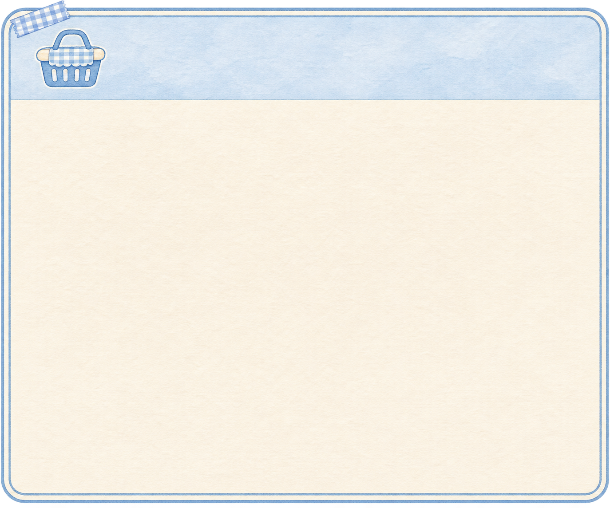

# 도깨비 마트 2주차 PRD

작성일: 2026-11-15
상태: 2주차 구현 기준
기준 자료: `PRE_PRD.md`, 사용자 제공 탑뷰·매대뷰 스크린샷 및 추가 요청

## 1. 목표와 적용 우선순위

마트 탑뷰에서 매대를 찾아 들어가 상품을 탐색하고, 카트에 담거나 버릴 수 있는 장보기 프로토타입을 만든다. **첨부 이미지의 화면 구성과 UI 위치를 최대한 그대로 재현하되, 탑뷰의 오른쪽 아래 조작법 영역은 카트 인벤토리로 교체한다.** 매대뷰에서 W/S 또는 위·아래 방향키로 구간을 바꿀 때 실제 월드의 플레이어와 카트도 매대 한 칸씩 함께 이동한다.

사용자의 이번 요청을 PRE_PRD의 초안보다 우선한다. 문서 내 충돌은 다음과 같이 정리한다.

| 항목          | 이번 PRD의 구현 기준                                                                                                |
| ------------- | ------------------------------------------------------------------------------------------------------------------- |
| 카테고리      | PRE_PRD 후반 상품표의 유제품·빵·음료수·라면·과자 5개를 사용한다. 앞부분의 화장품·야채·과일은 사용하지 않는다. |
| 매대뷰 형태   | 양쪽 매대와 가운데 통로라는 초안 대신, 이미지 2의 정면 매대와 가로 4개 상품 구성을 사용한다.                        |
| 이동 연동     | 3주차로 미뤘던 플레이어·카트 기본 이동과 매대 구간 위치 연동을 2주차에 포함한다.                                   |
| UI 기준       | 기존 PPT를 언급한 초안보다 이번 첨부 이미지의 위치·비율·구성을 우선한다.                                          |
| 이미지 리소스 | 최종 스프라이트 없이 도형·단색·텍스트로 구현하고 나중에 교체한다.                                                 |

아래 좌표와 색상은 첨부 이미지를 보고 산정한 배치 기준이다. 게임 규칙의 확정 수치와 구분하며, 실제 창 크기에 맞춰 같은 상대 위치와 비율을 유지한다.

## 2. 2주차 범위

- 로비에서 장보기 화면 진입 및 로비 복귀.
- 고정된 5개 카테고리, 세로 통로, 상·하단 연결 통로, 매대, 시작 지점의 계산대가 있는 탑뷰.
- 플레이어·카트 임시 도형, 기본 통로 이동 및 매대 진입 가능 거리 판정.
- 탑뷰 ↔ 매대뷰 전환, 매대 구간 탐색과 월드 위치 동기화.
- 160종 상품 데이터, 판별 상품 배치, 요구 수량이 있는 장보기 목록.
- 클릭으로 상품 담기, 카트 인벤토리 표시, 클릭으로 1개 버리기.
- 최종 이미지 없이 실행 가능한 임시 그래픽과 향후 스프라이트 교체 구조.

도깨비 AI·추적·탈취·공격·회수, 카트 분리·재결합, 제한시간 종료 판정, 계산 성공·실패, 보수·해금·랭킹·영구 저장은 후속 범위다. 타이머와 도깨비 구역의 **UI 위치는 이번 주에 구현**하되, 기능 연동 여부를 구분한다.

## 3. 화면 A — 마트 탑뷰

### 3.1 참고 이미지와 전체 배치

참고: `스크린샷 2026-11-14 175227.png` (1312 × 937).

이미지의 왼쪽 약 79%는 월드와 하단 안내 바, 오른쪽 약 21%는 고정 HUD다. 탑뷰 월드 카메라가 움직여도 HUD와 안내 바는 고정한다. 오른쪽 패널을 위·아래 또는 왼쪽으로 재배치하거나 별도 팝업으로 바꾸지 않는다.

| 영역            | 이미지 기준 대략적인 위치        | 구현 요구                                                                 |
| --------------- | -------------------------------- | ------------------------------------------------------------------------- |
| 월드 화면       | x 0~1030, y 0~818                | 짙은 바탕에 세로로 반복되는 분홍 매대, 회녹색 테두리, 밝은 회색 통로.     |
| 플레이어와 카트 | 예시 x 506, y 507 부근           | 파란 플레이어와 노란 카트를 인접 배치한다. 월드 좌표에 따라 표시한다.     |
| 상호작용 안내   | 월드 하단 중앙, y 약 775         | 옅은 노란색 `E 매대 살펴보기`. 실제 진입 가능한 매대 근처에서 표시한다. |
| 하단 안내 바    | x 0~1030, y 819~937              | 월드 영역 너비만 차지하는 짙은 청회색 바. 왼쪽 여백 약 24px.              |
| 오른쪽 HUD      | x 1031부터 오른쪽 끝까지         | 월드보다 어두운 배경. 내부 기본 왼쪽 여백 약 30px.                        |
| 게임명          | x 약 1062, y 약 44               | `도깨비 마트`, 밝은 회색 큰 글씨.                                       |
| 남은 시간       | 게임명 아래, y 약 96             | 황색 숫자와 `초`. 이미지의 212초는 예시값이다.                          |
| 미니맵          | x 약 1082, y 164~400             | 통로 선, 카테고리 이름, 플레이어·카트·도깨비 표식.                      |
| 미니맵 범례     | y 약 426~472                     | `파랑: 나  노랑: 카트`, 다음 줄 `보라: 도깨비`.                       |
| 장보기 목록     | 제목 y 약 509, 항목 y 약 560부터 | 종이 UI에 임시 아이콘·상품명·요구 수량만 표시한다.                      |
| 카트 인벤토리   | y 약 715부터 하단까지            | 기존 `카트 동반` 및 조작법 텍스트 블록의 자리를 대체한다.               |

이미지 오른쪽의 미니맵 일부는 잘려 보인다. 잘린 글자나 정보 누락까지 복제하지 않고, 같은 영역 안에서 전체 미니맵과 카테고리 이름을 읽을 수 있게 맞춘다. 화면 비율이 달라지면 기준 비율을 유지해 스케일하거나 여백을 두며, HUD 요소끼리 겹치지 않게 한다.

### 3.2 월드와 미니맵

- 여러 세로 통로를 상·하단의 가로 통로로 연결한다. 카테고리 구역과 세부 카테고리 순서는 판마다 바뀌지 않는다.
- 이미지처럼 매대가 세로 방향으로 칸 단위로 반복된다. 각 매대 칸에는 고유한 구간 번호와 접근 가능한 통로 위치가 있다.
- 플레이어와 카트는 벽·매대를 관통하지 않는다. 이번 주에는 카트를 동반한 상태로 이동하며 분리 입력은 제공하지 않는다.
- 미니맵의 플레이어·카트 위치는 실제 월드 좌표를 반영한다. 도깨비 구역과 범례는 이미지 위치를 유지하며, AI가 없는 상태의 임시 표시는 테스트용으로 구분한다.
- 계산대는 시작 지점에 표시한다. 도착에 따른 성공 판정은 이번 주에 실행하지 않는다.

### 3.3 장보기 목록

- 가장 최근 첨부한 UI 예시의 크림색 종이, 파란 테두리·체크무늬 테이프·클립, 남색 제목, 하단 도깨비 장식을 적용한다. 배경은 `assets/ui/shopping_list_panel.png`를 직접 로드한다.
- 각 행은 **임시 상품 아이콘 + 실제 상품명 + 요구 수량(예: 2개)**만 표시한다. 동일 상품은 한 행으로 합산한다.
- **체크박스·체크 표시·보유/요구 비교·달성 색상·취소선·진행률·모두 담음 알림과 자동 완료 확인 기능은 구현하지 않는다.** 플레이어가 목록과 카트를 직접 비교한다.
- 담기·버리기를 해도 목록의 요구 수량·색상·행은 변하지 않는다. 목록은 표시 전용이며 클릭해도 변화가 없다.
- 기본 5행으로 표시하고 초과 항목은 내용 영역 안에서 스크롤한다. 긴 이름은 줄바꿈한다. 예시의 상품명·수량은 디자인 설명이며 실제 카탈로그에 추가하지 않는다.

### 3.4 카트 인벤토리 — 3열 × 2행 슬롯 디자인

- 오른쪽 아래 조작법 블록 자리에 `assets/ui/cart_inventory_panel.png`를 넣는다. 최신 예시의 파란 헤더·바구니·테이프·둥근 슬롯 6개·하단 도깨비 디자인을 적용한다.
- 각 슬롯에는 **임시 상품 아이콘 + 실제 상품명 + 보유 수량 배지(xN)**를 별도로 그린다. 동일 상품은 한 슬롯에 합산한다.
- 상품이 있는 슬롯을 한 번 클릭하면 1개를 즉시 버린다. `x3 → x2 → x1 → 빈 슬롯`으로 변하며 확인창·수량 입력창은 없다.
- 0개가 되면 인벤토리 데이터와 해당 아이콘·이름·수량 배지를 모두 제거한다. 남은 상품은 순서를 유지해 앞으로 정렬한다. 빈 슬롯 클릭은 무시한다.
- 6칸은 화면에 보이는 슬롯 수이며 보유 종류 제한이 아니다. 초과 상품은 내용만 3개 단위로 내부 스크롤한다. 빈 상태는 `카트가 비어 있습니다`로 표시한다.
- 배경에 있는 제목과 `상품을 클릭하면 1개씩 버려요`는 중복해서 그리지 않는다. X는 예시 디자인을 유지한 장식이며 고정 HUD를 닫는 기능은 이번 범위에 포함하지 않는다.
- 장보기 목록 위·인벤토리 아래의 순서를 유지한다. 게임명·미니맵·타이머·하단 안내 바는 기존 위치에 둔다. 기존 조작법 전체를 다른 위치에 새로 만들지 않는다.

### 3.5 생성 이미지 적용과 동적 UI 구현 계약

최신 UI 예시와 이 절은 기존 텍스트형 목록·인벤토리 명세보다 우선한다. **이번 산출물은 UI 배경 이미지 2개와 구현 명세이며, 실제 게임 코드 연결은 2주차 구현 작업에서 수행한다.**

| 용도 | PRD 기준 상대 경로 | 이미지에 포함 | 코드에서 표시 |
| --- | --- | --- | --- |
| 장보기 목록 | `assets/ui/shopping_list_panel.png` | 종이·테이프·클립·제목·안내·행 구분선·마스코트 | 임시 아이콘·상품명·요구 수량 |
| 카트 인벤토리 | `assets/ui/cart_inventory_panel.png` | 헤더·제목·안내·6칸 테두리·마스코트 | 임시 아이콘·상품명·보유 수량 |

- 두 PNG는 예시 상품을 비워 둔 **재사용 가능한 배경 디자인**이다. 상품까지 배경에 합치면 버려도 사라지지 않으므로 배경과 상품 표시를 분리한다.
- 최종 상품 이미지는 아직 없으므로 작은 단색 사각형·원이나 단순 우유팩·빵·봉지 실루엣을 코드로 그린다. 공통 아이콘 키로 연결하고 추후 같은 키의 스프라이트만 교체한다. 예시의 당근·사과 등을 실제 상품 데이터에 추가하지 않는다.
- 매 프레임 `배경 PNG → 임시 아이콘 → 상품명·수량` 순서로 다시 그려 삭제된 상품의 잔상이 남지 않게 한다. PNG 바깥 투명 영역을 보존한다.
- 이미지 안의 제목·안내·장식은 정적 요소다. 상품 데이터와 수량만 실시간으로 갱신하며 장보기 목록은 담기·버리기에 반응하지 않는다.
- 기존 3.1의 좌표는 텍스트 UI 기준의 대략값이다. 새 디자인 적용 시 미니맵 아래 남은 HUD 공간을 목록과 인벤토리에 배분한다. 목록 위·인벤토리 아래 순서와 오른쪽 배치를 유지하되 y=715를 강제해 겹치지 않게 한다. 이미지 비율을 유지하고 여백·표시 해상도를 조절해 글자가 읽히도록 한다.
- 목록 배치 초기값(좌상단 원점, 이미지 전체 크기를 0~1로 정규화): 행 중심 y는 약 `0.365, 0.468, 0.571, 0.674, 0.777`, 아이콘 중심 x는 `0.17`, 이름 시작 x는 `0.25`, 수량 오른쪽 끝 x는 `0.84`. 행 높이 약 `0.085` 안에 표시한다.
- 인벤토리 슬롯 초기값: 열 x 범위 약 `0.07~0.35 / 0.37~0.64 / 0.66~0.94`, 행 y 범위 약 `0.32~0.59 / 0.62~0.89`. 아이콘은 중앙, 이름은 아래쪽, 배지는 아이콘 오른쪽 아래에 배치한다. 우하단 슬롯은 마스코트를 피하도록 표시 영역을 줄인다. 실제 렌더링 시 테두리·장식과 겹치지 않게 보정한다.
- 마우스 왼쪽 버튼 누름 이벤트 하나당 상품 ID 하나의 수량만 1 감소시킨다. 누르고 있는 동안 연속 삭제하지 않는다. 클릭 시 대상 ID를 먼저 확정하고 데이터 수정 후 슬롯을 재정렬해 같은 클릭이 다음 상품에도 적용되지 않게 한다.
- 클릭 판정은 실제 그려진 슬롯 사각형을 사용한다. 창 크기·좌표계·스크롤 변환을 반영하고 현재 보이는 상품 ID와 연결한다. HUD 클릭은 월드 클릭으로 전달하지 않는다. 장식·빈 칸 클릭으로 상품을 버리지 않는다.
- 프로젝트 최상위 `main.py`에서는 파일 위치 기준으로 `2주차/assets/ui/`를 찾아 로드한다. 실행 작업 디렉터리에 의존하지 않으며 이미지는 시작 시 한 번 로드해 재사용한다.

## 4. 화면 B — 매대뷰

### 4.1 참고 이미지와 배치

참고: `스크린샷 2026-11-14 175331.png` (1016 × 745).

매대뷰는 이미지 2처럼 **화면 전체를 정면 매대 화면으로 전환**한다. 탑뷰의 오른쪽 HUD를 추가로 끼워 넣거나 상품 카드를 격자로 늘리지 않는다. 장보기 목록과 인벤토리는 탑뷰로 돌아가 확인하며 데이터는 유지된다.

| 요소            | 이미지 기준 대략적인 위치         | 구현 요구                                                                |
| --------------- | --------------------------------- | ------------------------------------------------------------------------ |
| 배경            | 전체                              | 탑뷰와 유사한 짙은 청회색 단색.                                          |
| 코너 제목       | x 59, y 75 부근                   | `간식 코너`와 같은 현재 카테고리 제목, 큰 밝은 글씨.                   |
| 구간·이동 안내 | x 59, y 149 부근                  | `현재 구간 3 / 8 · W/S 또는 ↑/↓ 한 번에 한 칸 이동` 형식.           |
| 매대 프레임     | x 40~979, y 227~616               | 회녹색 직사각형 바탕, 위·아래 갈색 가로 선반.                           |
| 상품 4개        | x 약 94, 319, 543, 769 / y 약 295 | 같은 크기의 분홍 포장 도형을 한 줄로, 동일한 간격으로 표시한다.          |
| 상품명 라벨     | y 약 514~560                      | 상품 바로 아래 크림색 이름표, 어두운 글씨.                               |
| 담기·복귀 안내 | x 59, y 약 656                    | `상품을 클릭해서 담기 · E / Esc: 탑뷰로 돌아가기`.                    |
| 하단 상태 안내  | x 59, y 약 703                    | 황색 문구. 최종 통합 시 `탐색 중에도 시간과 도깨비는 계속 움직입니다.` |

- 상품 도형은 이미지처럼 상단의 크림색 띠와 `MART` 텍스트를 사용한다. 최종 상품 이미지는 추후 같은 표시 영역에 입힌다.
- 상품명은 실제 데이터로 표시한다. 예시 이미지의 브랜드 표기와 PRE_PRD의 이름이 다르면 PRE_PRD 상품표를 사용한다.
- 한 화면에 상품 4개를 표시한다. 긴 이름도 이름표 안에서 읽히게 줄바꿈 또는 글자 크기를 조절한다.
- 이미지의 `3 / 6`은 배치 예시다. 현재 데이터는 카테고리별 32종이므로 **4개 × 8구간**을 기본으로 한다. 모든 상품을 탐색할 수 있어야 한다.
- 2주차에 도깨비 AI가 없다면 하단 안내를 `탐색 중에도 시간은 흐릅니다. 도깨비 이동은 추후 연결됩니다.`로 표시한다. 위치와 황색 스타일은 유지한다.

### 4.2 진입과 복귀

1. 탑뷰에서 플레이어·카트가 매대 접근 위치에 도달하면 E 안내를 표시한다.
2. E를 누르면 접근한 매대의 카테고리와 현재 월드 위치에 대응하는 구간을 연다.
3. 양쪽 매대가 모두 가까우면 바라보는 방향의 매대를 우선한다. 어떤 매대를 여는지 접근 안내로 구분한다.
4. E 또는 Esc로 닫으면 마지막으로 탐색한 구간의 월드 위치에서 탑뷰로 돌아온다. 진입 전 위치로 되돌리지 않는다.
5. 같은 위치에서 재진입하면 같은 구간과 같은 상품 배열을 보여 준다.

## 5. 매대 탐색과 실제 위치 연동

**매대뷰의 탐색은 상품 페이지 번호만 바꾸는 동작이 아니다. 구간 변경과 플레이어·카트 월드 이동을 한 번의 동작으로 처리한다.**

| 입력                   | 매대뷰에서의 동작                                    |
| ---------------------- | ---------------------------------------------------- |
| W 또는 ↑              | 위쪽 매대 한 칸으로 이동, 구간 번호 -1               |
| S 또는 ↓              | 아래쪽 매대 한 칸으로 이동, 구간 번호 +1             |
| 상품 도형·이름표 클릭 | 해당 상품을 카트에 1개 담기                          |
| E 또는 Esc             | 현재 위치를 유지하고 탑뷰 복귀                       |
| A/D 또는 ←/→         | 매대뷰에서는 구간 이동이나 카테고리 전환을 하지 않음 |

- 구간 번호는 통로 위쪽부터 아래쪽으로 증가한다. 한 칸 거리는 월드에 배치한 인접 매대 구간의 접근 기준점 간 거리와 같다.
- W/S 한 번 누름에 정확히 한 칸 이동한다. 기본 구현은 키 누름 시작 이벤트를 사용하며, 키를 누르고 있다고 매 프레임 여러 칸 넘어가지 않는다. 같은 방향 키 두 개를 동시에 눌러도 한 칸만 이동한다.
- 구간이 바뀌면 표시 상품, 구간 번호, 플레이어 위치, 카트 위치를 함께 갱신한다. 카트는 플레이어와의 동반 간격을 유지한다.
- 첫 구간에서 위로, 마지막 구간에서 아래로 입력하면 위치와 표시를 유지한다. 반대쪽 끝으로 순환하거나 다른 카테고리로 자동 이동하지 않는다.
- 벽·장애물 등으로 플레이어 또는 카트가 다음 구간에 갈 수 없으면 이동과 구간 변경을 모두 취소한다. 구간 번호만 먼저 바뀌지 않게 한다.
- 매대뷰 동안 탑뷰용 자유 이동 입력을 중복 처리하지 않는다. 카메라가 숨겨져 있어도 실제 월드 위치는 갱신한다.
- 향후 도깨비와 타이머를 연결할 때 매대뷰 진입으로 월드 갱신을 정지하지 않는다. 이번 주 타이머는 경과를 보여 주는 테스트용으로 동작시키며, 0에서 실패 처리하지 않는다. 시작 시간은 설정값으로 둔다.

## 6. 상품·배치·수량 규칙

### 6.1 상품 구성

- PRE_PRD의 전체 상품 구성표 160종을 사용한다. 카테고리별 32종이며 세부 카테고리는 총 21개다.
- 유제품: 우유 8, 요플레 8, 치즈 8, 버터 4, 요구르트 4.
- 빵: 크림빵 8, 크림소금빵 8, 소금빵 8, 식빵 8.
- 음료수: 탄산음료 8, 주스·과즙음료 8, 커피·차 8, 이온·에너지·기타 8.
- 라면: 국물라면 8, 볶음·짜장라면 8, 특색라면 8, 컵라면 8.
- 과자: 감자·옥수수 스낵 8, 봉지 스낵 8, 쿠키·파이 8, 초콜릿·기타 8.

### 6.2 판별 배치와 목록

- 카테고리와 세부 카테고리 순서를 고정한다. 판 시작 시 각 세부 카테고리 안에서 상품 순서만 섞는다.
- 섞인 8종은 연속된 2개 구간에 4개씩, 4종은 1개 구간에 배치한다. 다른 세부 카테고리 상품을 섞지 않는다.
- 판 시작 시 생성한 배열을 저장하며, 매대 열기·닫기·구간 이동·담기·버리기로 재추첨하지 않는다.
- 장보기 목록은 실제 배치된 상품에서 생성한다. **스테이지 1은 요구 수량 합계 7~8개**이며, 상품 종류 수가 아니라 각 상품의 요구 수량을 더한 값이다.
- **유제품·빵·음료수·라면·과자 각 카테고리에서 반드시 1종씩** 무작위로 선정하여 총 5종을 표시한다. 카테고리 누락을 허용하지 않는다.
- **상품별 요구 수량은 1~2개**다. 각 상품을 1개씩 배정한 뒤, 서로 다른 2~3종에 1개씩 추가해 총 7개 또는 8개를 만든다. 이 제한은 요구 목록에 적용하며, 카트에 초과 수량을 담는 동작은 기존처럼 허용한다.
- 목록 상품 수·요구 수량 범위·제한시간은 조절 가능한 테스트 설정으로 분리한다. 이미지의 3개 목록·212초를 게임 전체의 고정 규칙으로 삼지 않는다.
- 이번 주 기본 재고는 무제한이다. 상품을 담아도 매대 상품이 사라지지 않는다. 이는 재고 정책 확정 전 프로토타입용 가정이다.

### 6.3 담기와 버리기

- 매대 상품을 한 번 클릭하면 보유 수량이 정확히 1 증가한다. 상품 도형과 이름표를 동일 상품의 클릭 영역으로 처리해 중복 담기를 막는다.
- 목록에 없는 상품과 요구 수량을 초과하는 담기를 허용한다. 이번 주에는 용량 제한을 두지 않는 테스트 구조로 만든다.
- 인벤토리 상품 슬롯을 한 번 클릭하면 보유 수량이 정확히 1 감소한다. 0인 상품은 삭제하고 음수는 허용하지 않는다.
- 담기와 버리기는 같은 인벤토리 데이터를 사용한다. 매대뷰를 닫으면 최신 인벤토리 수량을 표시한다. 장보기 목록의 요구 수량과 표시는 변하지 않는다.
- 판 재시작 시 인벤토리를 비우고 목록·배치를 다시 생성한다. 단순 화면 전환은 판 재시작으로 취급하지 않는다.

## 7. 데이터와 이미지 교체 기준

| 데이터        | 필요한 정보                                                       |
| ------------- | ----------------------------------------------------------------- |
| 상품          | 고유 ID, 표시 이름, 카테고리 ID, 세부 카테고리 ID, 공통 아이콘 키 |
| 매대 구간     | 매대 ID, 카테고리 ID, 구간 번호, 상품 ID 4개, 월드 접근 기준점    |
| 장보기 목록   | 상품 ID별 요구 수량                                               |
| 카트 인벤토리 | 상품 ID별 보유 수량                                               |
| 판 상태       | 생성한 배치, 목록, 인벤토리, 플레이어·카트 위치, 테스트 타이머   |
| 화면 상태     | 탑뷰/매대뷰, 현재 매대 ID와 구간 번호                             |

상품명 문자열을 식별자로 쓰지 않고 고유 ID로 연결한다. 클릭 영역·충돌 영역·이동 간격은 이미지 파일 크기와 분리한다.

최종 이미지가 없어도 도형과 텍스트로 모든 기능을 사용할 수 있어야 한다. 플레이어는 파란 도형, 카트는 노란 사각형과 바퀴, 매대와 상품은 이미지와 유사한 분홍·회녹색·갈색·크림색 도형으로 표현한다. 외형 때문에 2주차 기능 구현을 미루지 않는다.

추후 공통 아이콘 11종(우유·요플레·치즈·버터·요구르트·소금빵·식빵·음료·봉지라면·컵라면·과자봉지)을 연결한다. 크림빵·크림소금빵·소금빵은 우선 소금빵 공통 키를 공유하는 임시 매핑을 사용한다. 같은 아이콘을 쓰는 상품은 상품명으로 구분한다. 경로가 없거나 파일을 불러오지 못하면 임시 도형으로 대체한다. 최종 스프라이트 교체 시 UI 위치, 이름표, 데이터, 입력 및 충돌 규칙을 다시 작성할 필요가 없어야 한다.

## 8. 구현 순서와 산출물

| 순서 | 작업                                   | 산출물                                         |
| ---- | -------------------------------------- | ---------------------------------------------- |
| 1    | 상품 160종과 ID, 카테고리·구간 매핑   | 상품 카탈로그와 판별 배치 데이터               |
| 2    | 이미지 1 기준 탑뷰와 HUD               | 지도·미니맵·목록·카트 인벤토리 화면         |
| 3    | 플레이어·카트 기본 이동과 매대 접근   | 접근 안내와 E 진입                             |
| 4    | 이미지 2 기준 매대뷰                   | 4개 상품·이름표·구간·하단 안내              |
| 5    | W/S·방향키 구간 이동과 월드 위치 연동 | 탐색 후 해당 위치로 복귀하는 흐름              |
| 6    | 담기·버리기·인벤토리 수량 갱신           | 일관된 상품별 수량 처리                        |
| 7    | 화면 비교와 동작 검증                  | 실행 방법, 임시 설정값, 남은 기능·리소스 기록 |

## 9. 완료 및 검증 기준

- [ ] 로비에서 장보기 화면에 진입하고 복귀할 수 있다.
- [ ] 탑뷰의 월드·하단 바·오른쪽 HUD 비율과 각 UI의 위치가 이미지 1과 최대한 일치한다.
- [ ] 오른쪽 HUD에서 목록 위·인벤토리 아래 순서로 새 PNG를 적용하고 두 패널이 겹치지 않는다.
- [ ] 미니맵과 긴 상품명은 잘리지 않고, 많은 항목은 해당 영역 내부에서 스크롤된다.
- [ ] 매대뷰는 이미지 2처럼 큰 제목, 구간 안내, 가로 상품 4개, 이름표, 하단 안내 순서다.
- [ ] 5개 카테고리의 160종 상품이 누락·중복 없이 각 카테고리 8구간에서 탐색된다.
- [ ] 세부 카테고리 경계를 넘어 상품이 섞이지 않으며 같은 판의 재방문에서 배열이 유지된다.
- [ ] 매대 근처에서만 E로 진입하고 실제 위치에 맞는 구간이 열린다.
- [ ] 3번 구간에서 W/↑를 한 번 누르면 2번 구간과 위쪽 한 칸 위치, S/↓를 누르면 아래쪽 한 칸 위치가 함께 반영된다.
- [ ] 구간 이동 후 E/Esc로 닫으면 플레이어·카트가 마지막 탐색 구간에 있으며 미니맵도 같은 위치다.
- [ ] 처음·마지막 구간 경계, 키 길게 누름, 동시 입력, 이동 불가능한 구간에서 위치와 구간 번호가 어긋나지 않는다.
- [ ] 상품을 세 번 클릭하면 3개가 되고, 탑뷰 인벤토리에서 한 번 클릭하면 2개가 된다.
- [ ] 목록 밖 상품과 초과 수량을 담을 수 있고, 모두 버리면 해당 상품의 아이콘·이름·수량 배지가 사라진다.
- [ ] 목록에 체크박스·수량 비교·달성 표시·완료 알림이 없고 담기·버리기로 요구 목록이 변하지 않는다.
- [ ] 스테이지 1 목록은 5개 카테고리를 모두 포함하고, 상품별 요구 수량은 1~2개이며 수량 합계는 7~8개다.
- [ ] 매대뷰에서도 테스트 타이머는 흐르며, 0이 되어도 미구현 실패 흐름으로 넘어가지 않는다.
- [ ] 최종 스프라이트가 없어도 실행되고, 이미지만 교체해도 배치·클릭·이동 규칙이 유지된다.

- [ ] 두 PNG가 실제 UI에 로드되고 상품 아이콘·이름·수량은 별도로 그려진다.
- [ ] x1 슬롯 클릭 시 상품 표시가 완전히 사라지고, 빈 칸·장식 클릭은 무시된다.
- [ ] 길게 눌러도 한 번만 버리며 재정렬 후 다른 상품이 함께 삭제되지 않는다.
- [ ] 인벤토리 7종 이상에서 스크롤 후 클릭한 상품의 수량만 줄어든다.

## 10. 후속 작업

3주차 이후 도깨비 행동, 카트 분리·재결합, 제한시간 종료와 계산 판정, 보상·저장을 연결한다. 최종 스프라이트를 준비한 뒤 이번 문서의 도형 표시 영역에 적용한다. 2주차 종료 시 기본 이동과 매대 탐색 위치 연동은 완료되어 있어야 하며, 이 기능을 다시 후속 작업으로 미루지 않는다.

상품별 정확한 표시 이름은 [PRE_PRD 전체 상품 구성표](PRE_PRD.md)의 32행 × 5열을 원본 카탈로그로 참조한다. 이 PRD는 해당 표의 상품 구성을 유지하면서 화면 배치와 상호작용 요구를 확정한다.
